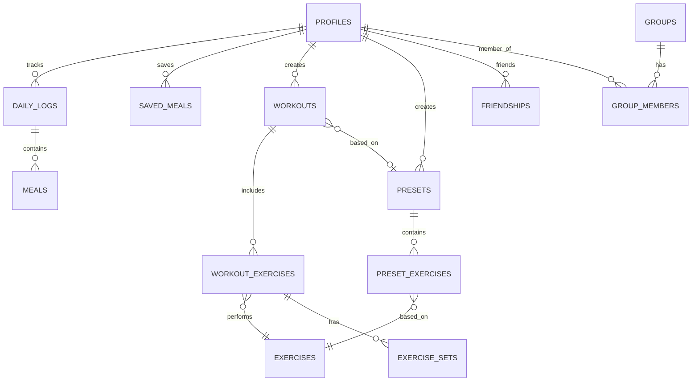

# GymTracker React Native App

Build the GymTracker mobile app from the design sketches (`Design.pdf`) and data model (`ER_Diagram.pdf`) using **Expo (managed) + Expo Router + TypeScript**, with **Supabase** for Postgres, Auth, and Storage. Runs on Android and iPhone via Expo Go / dev builds.

## Scope (confirmed)
- **Build now (Phase 1):** Auth (signup/login), Home (streaks + today's macros), Nutrition (daily calories/macros, add meal manually, photo attachment, recent + saved meals), Workouts (calendar, presets Push/Pull/Legs/Shoulders, exercises with sets/reps/weight/dropsets), Profile.
- **Deferred:** Social (friends, groups, public profiles, pinging) and OCR photo scanning. DB schema will still include social tables so no migration rework later; only their UI is deferred.

## Tech stack & dependencies (to be installed)
- Core: `expo`, `expo-router`, TypeScript template
- Data/Auth: `@supabase/supabase-js`, `@react-native-async-storage/async-storage`, `react-native-url-polyfill`
- State/fetching: `@tanstack/react-query`
- UI/utility: `react-native-calendars`, `expo-image-picker`, `date-fns`, `@expo/vector-icons`, `react-native-safe-area-context`, `react-native-screens`, `react-native-gesture-handler`, `react-native-reanimated`

Installed via `npx create-expo-app` + `npx expo install`.

## Data model (Supabase)
Matches the ER diagram. Core tables built now; social tables created but UI deferred.



Key columns:
- `profiles`: `id` (FK `auth.users`), `username` (unique), `is_private`, `avatar_url`, `calorie_goal`, `protein_goal`, `carbs_goal`, `fats_goal`, `current_streak`, `longest_streak`, `last_active_date`.
- `daily_logs`: `user_id`, `log_date`, unique(`user_id`,`log_date`); macro totals derived from meals.
- `meals`: `daily_log_id`, `name`, `meal_type`, `calories`, `protein`, `carbs`, `fats`, `photo_url`, `logged_at`.
- `saved_meals`: reusable meal templates per user.
- `exercises`: `name`, `muscle_group`, `is_default`, `created_by` (seeded with common lifts).
- `workouts` -> `workout_exercises` (ordered) -> `exercise_sets` (`set_number`, `reps`, `weight`, `is_dropset`).
- `presets` -> `preset_exercises` (`target_sets`, `target_reps`).
- Social (schema only now): `friendships`, `groups`, `group_members`.
- **RLS** on every table: users access only their own rows; public profiles / friends readable later. A SQL trigger/RPC updates streak fields on log activity.

Delivered as `supabase/migrations/0001_core.sql` + `0002_social.sql` + `0003_seed_exercises.sql` to run in the Supabase SQL editor. Generated TS types in `types/database.ts`.

## App structure (Expo Router)
```
app/
  _layout.tsx            # providers: SafeArea, QueryClient, Auth, Supabase session gate
  (auth)/login.tsx, signup.tsx
  (tabs)/_layout.tsx     # bottom tabs: Home | Nutrition | Workouts | Profile
  (tabs)/index.tsx       # Home: current + longest streak, today's calories/macros rings
  (tabs)/nutrition/index.tsx, add-meal.tsx
  (tabs)/workouts/index.tsx, [date].tsx, presets.tsx
  (tabs)/profile.tsx
lib/supabase.ts, lib/auth.tsx, lib/streak.ts
components/ (MacroRing, Card, ExerciseSetRow, MealRow, Calendar, buttons/inputs, theme)
hooks/ (useDailyLog, useMeals, useWorkouts, usePresets, useProfile)
```
Design's sidebar is adapted to standard mobile **bottom tabs** (works identically on Android/iOS). Secondary screens (add-meal, workout day, presets) are pushed routes.

## Config
- App builds with a `.env` using `EXPO_PUBLIC_SUPABASE_URL` and `EXPO_PUBLIC_SUPABASE_ANON_KEY`, plus `.env.example`, read via `expo-constants`/`process.env`. After the Supabase project is created and migrations are run, add the URL + anon key to `.env` to make it fully live.

## Verification
- `npx expo start`, open in Expo Go on an Android phone (and iPhone). Smoke-test: signup -> login -> log a meal -> see Home macros update -> create a workout with sets -> save/apply a preset.

## Implementation steps
1. Scaffold Expo + Expo Router + TypeScript project; configure `app.json`, `tsconfig`, folder structure.
2. Install dependencies (supabase-js, async-storage, react-query, react-native-calendars, expo-image-picker, date-fns, safe-area/screens/gesture/reanimated).
3. Write Supabase SQL migrations: core tables, social tables, RLS policies, streak trigger/RPC, seed common exercises; generate `types/database.ts`.
4. Set up `lib/supabase.ts` with AsyncStorage session persistence, url-polyfill, `.env` + `.env.example` config.
5. Build Auth context/provider + session gate in root `_layout`, and login/signup screens.
6. Build bottom tab navigator (Home/Nutrition/Workouts/Profile), shared theme and reusable UI components (Card, buttons, inputs, MacroRing).
7. Build Home screen: current & longest streak, today's calories + protein/carbs/fats, quick links to Nutrition and Workouts.
8. Build Nutrition: daily calorie/macro page with manual editable goals, add-meal screen (manual entry + photo attachment via image-picker), recent and saved meals.
9. Build Workouts: month calendar, per-day workout with exercises + sets (reps/weight/dropset), presets (Push/Pull/Legs/Shoulders) create/apply.
10. Build Profile screen: username, avatar, privacy toggle, macro goals, today's stats and current streak; sign out.
11. Wire React Query hooks (useProfile, useDailyLog, useMeals, useWorkouts, usePresets) and streak update logic on log activity.
12. Run via Expo Go and smoke-test core flows on Android; fix cross-platform (iOS) issues.
